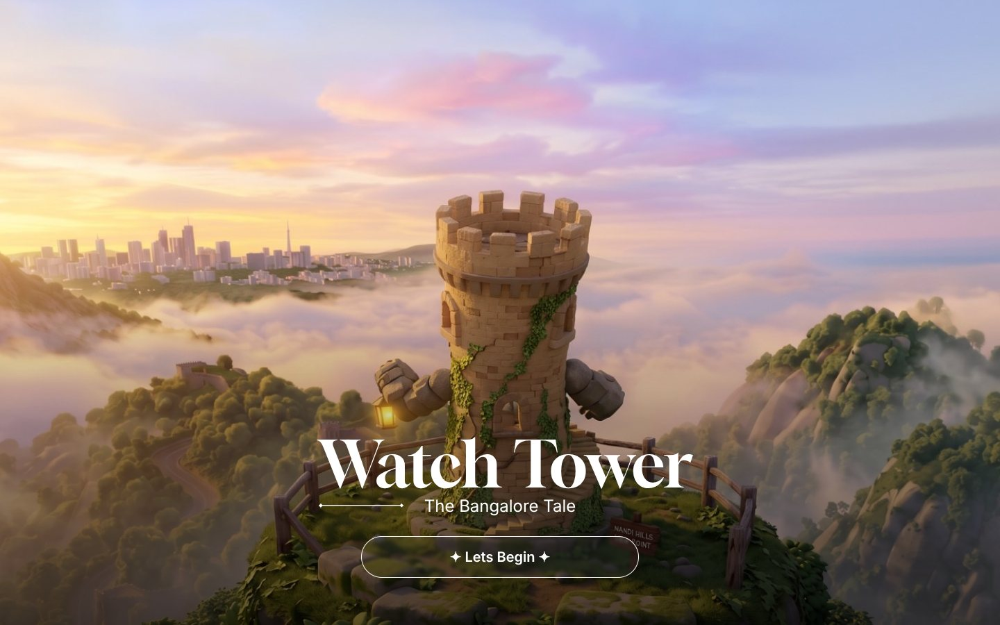
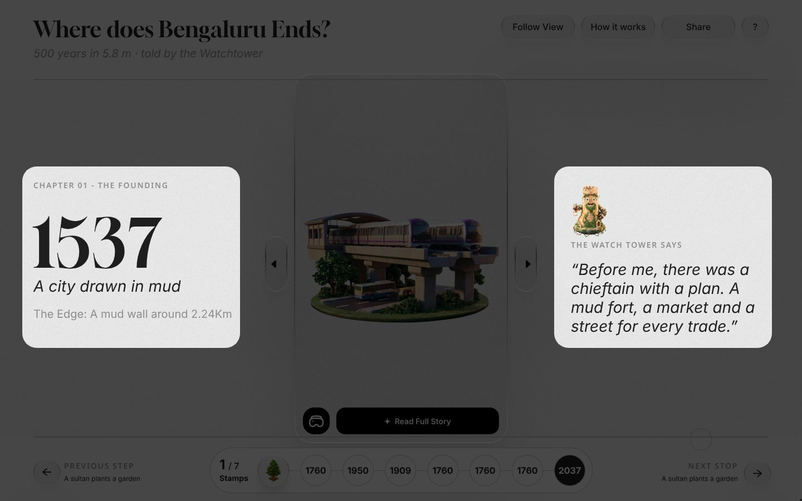
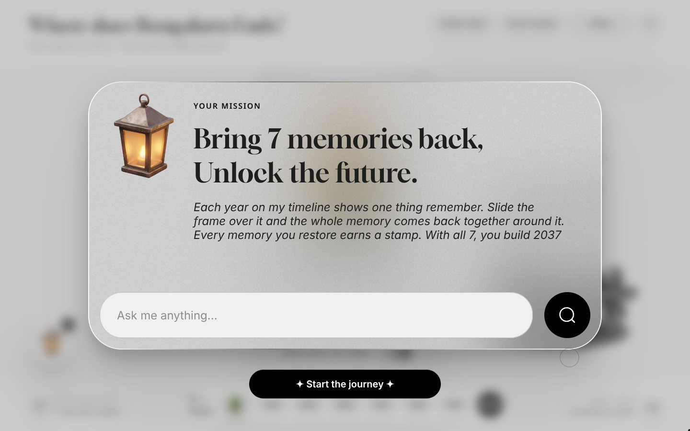
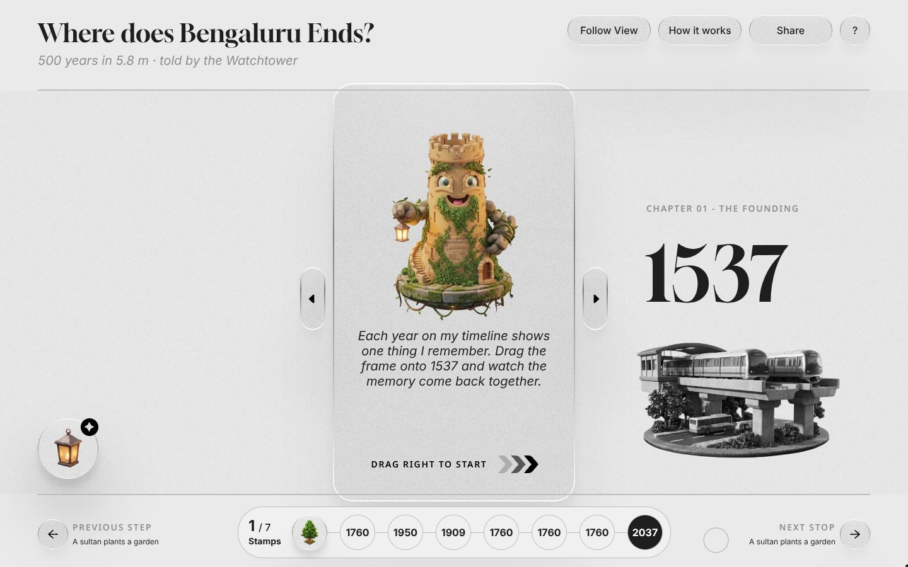
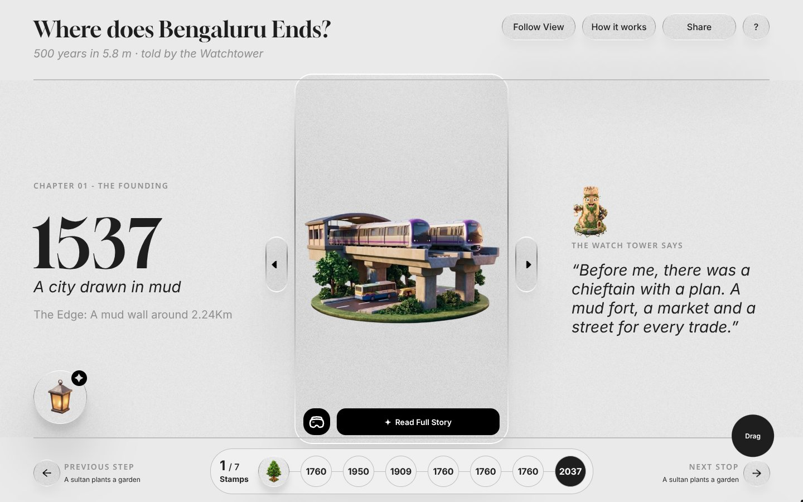
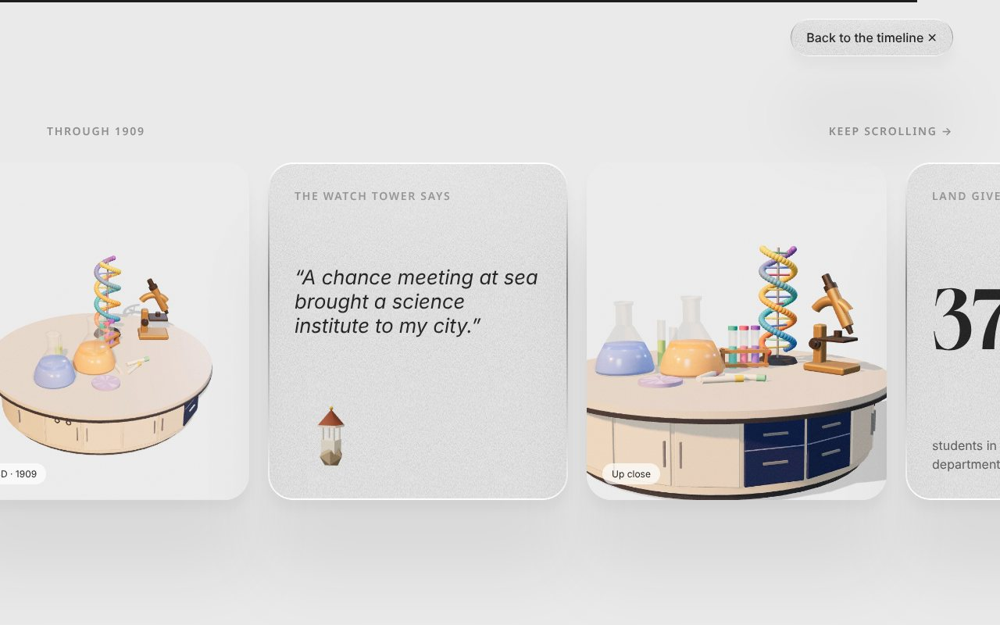
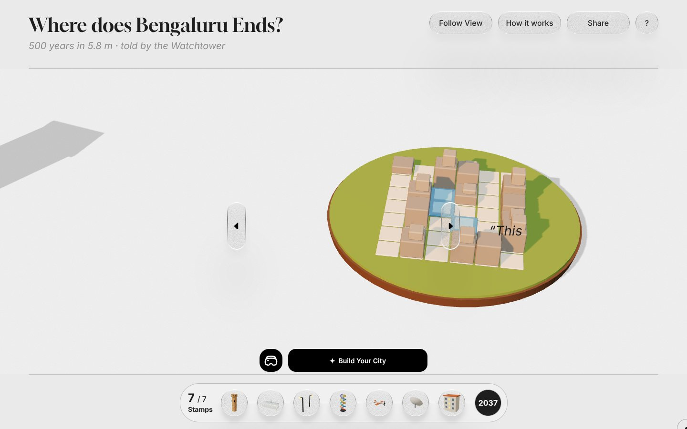

# Where does Bengaluru Ends?

*500 years in 5.8 m · told by the Watchtower*

A digital slider museum timeline of Bengaluru, narrated by Kempegowda's Watchtower. A glass frame slides along a 500-year timeline. Wherever it lands, a 3D memory of the city assembles itself and comes alive.

## Run it

Open `index.html` in a modern browser. Everything is in that one file. It loads Three.js, GSAP, Lenis and StringTune from jsdelivr, so it needs an internet connection.

## Features

**Opening and onboarding**
- Landing screen with a slow background zoom and the title rising in
- First-visit walkthrough with 4 coach marks: Brief story, Timeline stamps, Read full story, VR. An 80% black mask with cutouts and dashed connectors, built to the Figma. Tap anywhere to continue, Skip or Esc to close. It never changes progress
- Mission panel with the lantern guide
- Plain start frame: "Drag me to begin the journey". Drag it right and the 1537 world fades in

**The sliding frame**
- Drag, flick or scroll the glass frame along the timeline. It always settles on the next year in the direction you moved (GSAP snap tweens, Lenis wheel and trackpad smoothing)
- Side handles, arrow keys and previous/next buttons step one year at a time
- Begin Again clears the stamps and returns to the start frame

**An endless 3D world**
- One continuous procedural landscape to the horizon: hills, lakes, farmland, golden-hour sky and fog
- The city grows by era, from huts and mud walls to colonial blocks, factories, towers, a metro and wind turbines
- Traffic for each era, people, birds, chimney smoke, lamps and swaying trees
- Default view: each stop's main 3D asset sits centred in full colour with extra surface detail. The rest of the world is muted and fades into the page
- VR view fills the screen in full colour

**Story and game**
- Chapter text and the Watchtower's narration for every stop
- "Read Full Story" opens a scrolling chapter page (Lenis smooth scroll, GSAP ScrollTrigger)
- Stamp passport with the 7 Figma stamps. All 7 unlock 2037, where you build your own city and share it by link
- How it works and Share

**Lantern assistant (UI ready)**
- Launcher and "Ask me anything" bar with all designed states (empty, focused, typing)
- Fires a `lantern:ask` browser event with the typed text; not yet connected to an AI service

**Quality**
- Built to the Figma frames at 1440 × 900; responsive down to phones
- Keyboard navigation, visible focus states and reduced-motion support

| | |
|---|---|
|  |  |
|  |  |
|  |  |

## Editing

- `src/shell.html`: layout and CSS
- `src/app.js`: 3D world, interaction, onboarding and assistant states
- `src/figassets.js`: Figma artwork as data URLs (originals in `src/assets/`)
- `src/renders.js`: reference renders shown on chapter pages

Rebuild after editing: `python3 src/build.py`

## Known gaps

- Noe Display is a licensed font and is not included. Gloock stands in.
- The lantern assistant has no reply, loading or error designs yet, so sending a message shows nothing.
- Stamps for years other than 1537 are rendered from the 3D models.

## Built with

Three.js · GSAP ScrollTrigger · Lenis · StringTune
